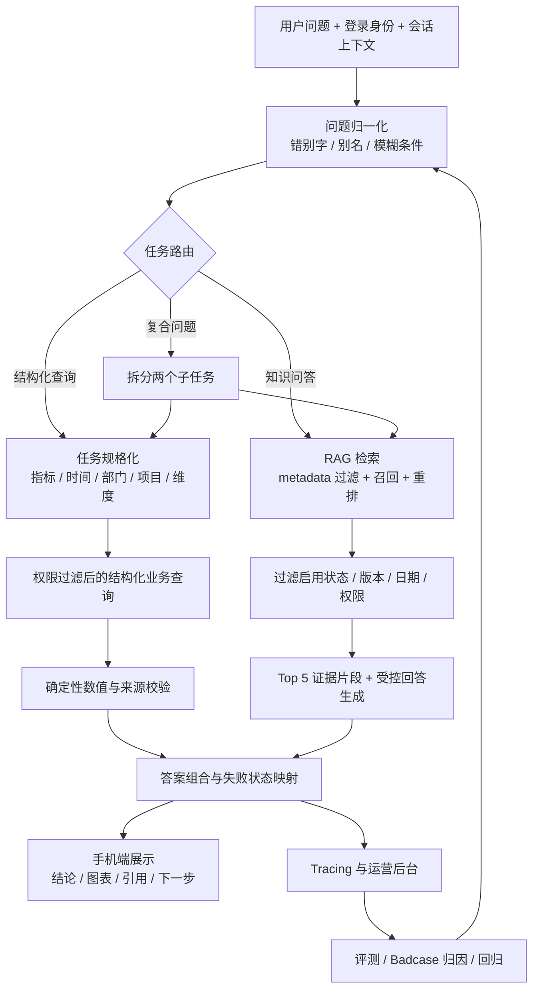
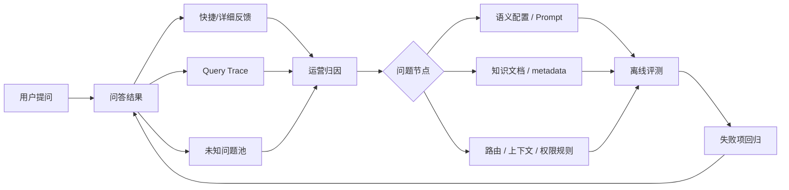

# Agent 工作流与架构 · 智能经营数据问答助手

> 本文说明一条问题从进入系统到返回答案的完整处理链路、各节点职责与失败模式、关键设计取舍与技术实现。需求背景见 [PRD](PRD.md)，评测口径见 [评测体系设计与发现](评测体系设计与发现.md)。

---

## 1. 为什么是"固定 Workflow"而不是"多 Agent"

经营查询的任务路径是**稳定且可预先拆解**的：识别 → 规格化 → 查询/检索 → 校验 → 展示。因此采用**固定 Workflow（确定性编排）**，而非让大模型自主规划的多 Agent：

| 维度 | 固定 Workflow（本项目） | 开放式多 Agent |
|---|---|---|
| 成本/延迟 | 低、可控（节点可裁剪） | 高、不确定（多轮自主调用） |
| 可观测性 | 每节点可 Trace、可评测 | 归因困难 |
| 正确性保证 | 数值/权限由确定性节点兜底 | 依赖模型自律 |
| 适用场景 | 任务路径稳定 | 跨系统开放分析、动态选工具 |

> 结论：**AI 处理模糊性（语义/检索/表达），确定性系统处理确定性（数值/权限/版本/状态）**。只有当任务演化为开放式跨系统规划时，才引入 Sub-agent / Agent Team。

## 2. 端到端链路总览



## 3. 各节点职责、评价标准与典型失败

| 节点 | 输入 | 输出 | 评价标准 | 典型失败 |
|---|---|---|---|---|
| 问题归一化 | 原始问题 | 标准问题 / 纠正项 / 澄清请求 | 不改变实体含义；歧义不猜测 | 把制度问题误改成金额问题 |
| 任务路由 | 标准问题 + 上下文 | STRUCTURED / RAG / COMPOSITE | 路由符合真实任务 | 复合问题只执行一个子任务 |
| 任务规格化 | 经营问题 | 指标/时间/部门/项目/维度 | 必要字段完整；继承正确 | "按项目排一下"丢失上一轮范围 |
| 结构化查询 | 任务规格 + 身份 | 数值/记录/分析序列/来源 | 数值正确、范围不越权 | 项目只显示内部 ID |
| RAG 检索 | 问题 + 身份 + 时间 | 最相关 5 个可访问片段 | 版本有效、引用支撑答案 | 召回过期或受限文档 |
| 回答生成 | 检索证据 / 业务结果 | 有结论的业务或制度回答 | 不编造、先结论、可行动 | 正确但机械、失败原因不明 |
| 结果校验 | 回答 + 状态 + 来源 | 可展示结果或兜底状态 | 数值/引用/权限/状态一致 | 无权限被误说成没数据 |
| Tracing | 各节点输入输出 | trace/日志/未知问题/复核 | 可定位失败节点 | 只看到失败，不知失败在哪 |

## 4. 任务路由逻辑

路由把问题分到三条主路径（对应系统意图标签）：

- **STRUCTURED（结构化经营查询）**：涉及采购金额、立项金额、采购结果等可计算指标 → 走指标服务 + 数据库。
- **RAG（制度知识问答）**：涉及口径、流程、招标阈值、采购方式等制度解释 → 走知识库检索。
- **COMPOSITE（复合问题）**：一句话同时包含经营数据与制度解释（如"查本季度采购金额，并说明达到多少要公开招标"）→ 拆成两个子任务分别执行，再组合为双来源答案。

路由同时输出 `intent / intent_group`，并作为**意图门控**：问候、转人工、无依据等不触发 RAG，避免无效检索。路由错误是复合问题的高发失败点（见 §7 Badcase）。

## 5. 多轮上下文：继承"任务规格"而非聊天文本

多轮能力的核心不是保存聊天气泡，而是保存**可执行的任务规格**（指标、部门、项目、时间、分析维度）。

- 用户上一轮查"本部门年度采购金额"，这一轮说"按项目排一下" → 系统**保留上一轮规格，只覆盖本轮明确修改的字段**（分析维度→按项目）。
- 规则：检测到换项目/明确换问题/业务域变化时，清理不该沿用的字段；不把未知实体强行映射为已有项目。
- 这样既能接住省略式追问，又不会污染上下文。

## 6. RAG 知识库设计

### 文档模型
每个文档保存：标题、分类、部门、版本、生效日期、过期日期、权限等级、启用状态、发布状态。切分后每个 chunk 保留文档 ID、标题层级、页码、原文与访问元数据。

### 检索流程
```
用户问题
 → 结合上下文生成检索问题
 → 向量召回候选片段
 → 按文档状态 / 当前版本 / 生效日期 / 用户权限过滤（先过滤，不只在页面隐藏）
 → 候选重排
 → 返回 Top 5 证据
 → 模型仅依据证据生成回答（无依据则拒绝给确定性结论，不用常识补制度）
 → 输出引用文档 ID / 版本 / 原文片段
```

### 关键取舍
| 决策 | 选择 | 原因 |
|---|---|---|
| 切分 | 按标题/段落 | 保留制度语义边界，便于解释引用 |
| 业务元数据 | 部门/版本/日期/权限/状态 | 先过滤再生成，避免侧漏 |
| 召回 | 扩大候选后重排取 Top 5 | 兼顾召回覆盖与上下文噪声 |
| 无依据 | 拒绝生成确定性结论 | 防模型用常识补企业制度 |
| 引用 | 强制绑定检索 chunk | 答案可回到原文复核 |

## 7. 代表性 Badcase（工作流如何被评测驱动修改）

> 完整分析见 [迭代与 Badcase](迭代与badcase.md)。此处举 Workflow 层面的典型：

- **复合问题 0/5**：早期单一路由，一个请求只能进结构化或 RAG → 修改为**复合意图拆分 + 双子任务执行 + 双来源组合**，这是**架构级**修改而非改 Prompt。
- **模糊追问丢上下文**：会话只存文本，未把上一轮任务规格用于下一轮 → 改为**任务规格继承 + 字段覆盖规则**。
- **多轮追问崩溃（本次评测新发现的真实缺陷）**：上下文继承处对空值未防护导致运行时崩溃 → 修复空值处理并纳入回归。

## 8. 可观测与闭环



这条闭环是 AI 产品经理的核心工作：不是功能上线即结束，而是通过反馈与评测把失败**定位到具体链路节点**，再决定改 Prompt、知识、规则还是交互。

## 9. 技术实现概览

| 层级 | 技术/模块 | 作用 |
|---|---|---|
| 前端 | Next.js 16、React 19、TypeScript | 手机端 + 运营后台 |
| 业务数据 | SQLite、Drizzle ORM | 模拟经营记录、账号、权限、会话、日志、评测 |
| 向量检索 | 向量库（本地演示） | 文档 chunk 向量存储与语义召回 |
| 文档处理 | Markdown/TXT/PDF 解析 | 元数据保存、标题段落切分、入库 |
| 大模型 | DeepSeek Chat | 受控意图解析与基于证据的回答生成 |
| 可视化 | Recharts | 业务表格与图表 |
| 鉴权 | JWT 会话 + 角色 | 四类角色权限与审计 |
| 测试 | Vitest、Playwright | 单元、接口、UI 与浏览器验证 |

## 10. 关键产品决策与取舍

| 决策 | 选择 | 放弃/推迟 | 原因 |
|---|---|---|---|
| 执行架构 | 固定 Workflow | 多 Agent 编排 | 路径稳定，更低成本/延迟、易追踪 |
| 数值回答 | 数据库确定性计算 | 让模型从文本算 | 避免金额幻觉与口径漂移 |
| RAG 权限 | 检索前 + 召回后双重过滤 | 只在页面隐藏 | 防标题/片段/相似度侧漏 |
| 失败处理 | 原因码 + 状态策略 + Prompt 表达 | 统一"未找到数据" | 让用户理解原因并继续行动 |
| 评测执行 | 自动检查 + 人工复核 + 自动 LLM-as-Judge | 只看自动准确率 | 语义完整性与自然度需人判断 |
| 数据环境 | 固定种子模拟数据 | 虚构真实企业接入 | 可重复、可公开、边界诚实 |
